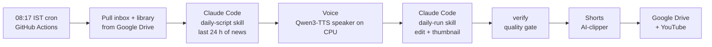

# AI News Editor: an autonomous daily tech news channel (software, AI, hardware)

An AI agent that runs a faceless YouTube news channel end to end. Every morning a GitHub Actions run:

1. Researches the **last 24 hours** of tech and AI news and writes a 6–10 story roundup, with a source for every figure.
2. Records the voiceover with a built-in English male TTS voice (Qwen3-TTS, on CPU).
3. Edits a finished 16:9 video: newsroom look, story counter, news screenshots of the real sources, motion
   graphics, sound design.
4. Makes the daily thumbnail: the channel's design with a dramatic hook from the day's script, and the logos of
   the companies and photos of the people in the day's biggest stories.
5. Cuts YouTube Shorts from it and writes the upload metadata.

Everything lands in Google Drive (and on YouTube, scheduled, once enabled). It runs on free tiers (GitHub Actions and
Google Drive); the only paid part is a Claude subscription.

Channel: **24 Hours in Tech** (`@24HoursInTech`, profile in `config/brands/ai-news.json`).

This repo started as a copy of [ai-video-editor](https://github.com/SrigadaAkshayKumar/ai-video-editor) (the
Crack IT channel's pipeline) and runs separately from it.

---

## How it works

| Stage | What happens | Built with |
|---|---|---|
| **Plan** | Today's episode number and what it needs | `tools/daily.mjs` |
| **Script** | 6–10 stories from the last 24 h, biggest first; every figure from an official source or two reputable outlets; `stories.json` names each story's companies and people | Claude Code skill `daily-script` |
| **Voice** | A built-in English male speaker with a clear American accent (`Aiden`; no voice cloning), paragraph chunks, each checked against the expected speaking time | Qwen3-TTS 0.6B CustomVoice, `tools/voice/tts.py` |
| **Edit** | Transcribe → clean cut → direction pass → visual plan → render → SFX mix → master at -14 LUFS → `verify` | Claude Code skills + Remotion + HyperFrames + ffmpeg |
| **Thumbnail** | A hook from the day's script + the day's cast: logos and cut-out photos of public figures, free-licensed from Wikimedia, fetched once and kept in a Drive library | `tools/library.mjs`, `tools/thumb-design.mjs` (`roundup` template) |
| **Shorts** | Self-contained moments as 9:16 clips | `AI-clipper/` |
| **Package** | Title from a fixed formula + date + top names, chapters per story, sources, tags | Claude Code skill `youtube-metadata` |
| **Deliver / publish** | Drive, then a scheduled YouTube upload (20:30 IST) | rclone, YouTube Data API, `tools/youtube.mjs` |

### Design choices

- **Decisions live in files, tools are re-runnable.**
- **The agent never asks; it reports** (`daily-script-report.md`, `daily-report.md`, with a source for every number).
- **Quality gates before upload:** `verify`, plus `script-check` before the voice reads anything.
- **Fact safety:** unconfirmed news is labelled "reported"; a figure that can't be confirmed is left out.
- **Real people and logos, editorial use only:** free-licensed images with attribution, never altered beyond a
  background cut-out, never words put in anyone's mouth.
- **Public repo, private data.** No media, library images or keys in git.

## Run it

**Daily and unattended:** follow [docs/cloud-setup.md](docs/cloud-setup.md) (Drive folder, rclone login, GitHub
secrets, YouTube). Then it runs every day at 08:17 IST, or on demand from **Actions → Daily edit → Run workflow**.

**Manually:** see `CLAUDE.md` for the commands; any voiceover in `inbox/faceless/` can be edited with
"edit faceless using …".

---

**Author:** Srigada Akshay Kumar ([@SrigadaAkshayKumar](https://github.com/SrigadaAkshayKumar))
