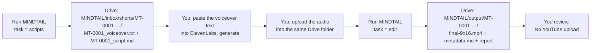

# MINDTAIL on this engine (branch `mindtail`)

This branch adapts the ai-news-editor engine for **MINDTAIL** (@MIND_TAIL_99): faceless Hindi/Hinglish
**YouTube Shorts only**, built from real stock B-roll, Remotion motion graphics, Hindi captions and careful
music + SFX mixing. `main` stays the 24 Hours in Tech news pipeline; nothing here changes it.

## How a Short gets made



1. **GitHub → Actions → MINDTAIL → Run workflow**, "Use workflow from: **mindtail**", task **scripts**
   (count = how many; note = topics if you want specific ones).
2. In Google Drive open `MINDTAIL/inbox/shorts/`. Each new folder has:
   - `MT-XXXX_voiceover.txt`: **copy all of it into ElevenLabs** and generate the Hindi voice,
   - `MT-XXXX_script.md`: the scenes, what is on screen, the sources and title ideas (read it if you like).
3. **Upload the ElevenLabs audio (mp3/wav) into that same folder.** Any file name; exactly one audio file.
   Optional: a `brief.txt` with style words just for that Short.
4. Run the workflow again with task **edit**. It edits every Short that has audio (or the one named in
   `short`), up to `count` per run.
5. The finished Short lands in `MINDTAIL/output/MT-XXXX-…/`: `final-9x16.mp4`, `metadata.md` (titles,
   description, hashtags, disclosure), `mindtail-report.md` (what was done, sources, what to check).
   A failed edit leaves its report in `MINDTAIL/output/_failed/`.

Task **status** lists every Short and what it is waiting for.

**Comparing looks**: tick **variants** on an edit run to also get the same Short in the other looks of
`config/mindtail.json` → `looks` (A cinematic/liquid, B bold/broadcast, C clean/glass) in
`MINDTAIL/output/MT-XXXX-…/variants/`. Same cut, footage and sound; only the visual style and captions differ.

## Drive layout

```text
MINDTAIL/
├── inbox/shorts/MT-0001-phone-habit/   MT-0001_voiceover.txt, MT-0001_script.md, <your audio>, [brief.txt]
└── output/
    ├── MT-0001-phone-habit/            final-9x16.mp4, metadata.md, mindtail-report.md, credits
    ├── _script-reports/                one report per script batch (topics, sources)
    ├── _failed/                        reports of edits that did not pass
    └── _logs/                          Claude's logs (the repo is public, so not in GitHub)
```

The folder is created on the first run, with the same Google login the news channel uses (`RCLONE_CONF`).
To use another folder name, set the repository variable `MINDTAIL_DRIVE_ROOT`.

## Pieces

| File | What it does |
|---|---|
| `.github/workflows/mindtail.yml` | the runs above; manual only, runs only from this branch, **no YouTube step** |
| `tools/mindtail.mjs` | bookkeeping: status, next IDs, voiceover checks, which Shorts are ready, result checks |
| `.claude/skills/mindtail-script/` | how Claude picks topics, sources facts and writes the Hindi voiceover |
| `.claude/skills/mindtail-edit/` | how Claude edits one Short (9:16, Hindi captions, b-roll, music + SFX) |
| `config/mindtail.json` | standing brief, topics, word range, style, batch sizes |
| `config/brands/mindtail.json` | brand profile (audience, palette, content rules) |
| `config/mindtail-state.json` | which Shorts are finished (committed by the workflow) |
| `brand-guidelines.md`, `backlog.md`, `MINDTAIL_BLUEPRINT.md` | brand rules, example ideas, the original brief |

## Costs to know

- **Word timings are free**: the edit force-aligns your `MT-XXXX_voiceover.txt` to the audio with Meta's MMS
  model (`tools/align/align.py`, runs on the GitHub machine). No ElevenLabs key or credits; captions are spelled
  exactly as the script. If the audio says something different from the text file, the report says so.
- **ElevenLabs**: only for generating the voice yourself.
- **Licence**: ElevenLabs' free plan is non-commercial and asks for attribution; a monetised channel needs a
  plan with commercial rights.
- Claude runs on the same `CLAUDE_CODE_OAUTH_TOKEN` as the news channel.

## Decisions (2026-11-13)

| Topic | Decision |
|---|---|
| Format | Shorts only, native 9:16, 40-80 s |
| Content | General youth content: shocking-but-true and mind-blowing facts, mind/psychology, stories & mysteries, motivation, modern life & social media, relatable youth topics |
| Tagline | None |
| Voice | Owner generates it in ElevenLabs from `*_voiceover.txt` and uploads it to Drive |
| Delivery | Google Drive only. **No YouTube upload** until the owner has tested Shorts and says so; MINDTAIL then needs its own YouTube login (the `YT_*` secrets are 24 Hours in Tech's) |
| Style | `liquid` to start (config/mindtail.json); to be judged on the first test Shorts |

## Still open

MINDTAIL's own Remotion look after the first tests, voice plan, cadence, YouTube login and upload slot,
logo/banner without tagline.
